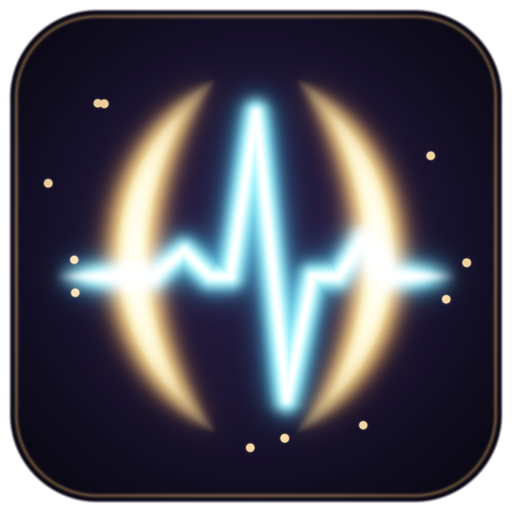
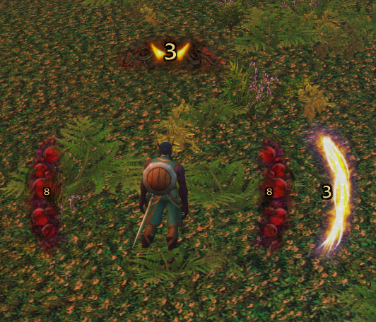
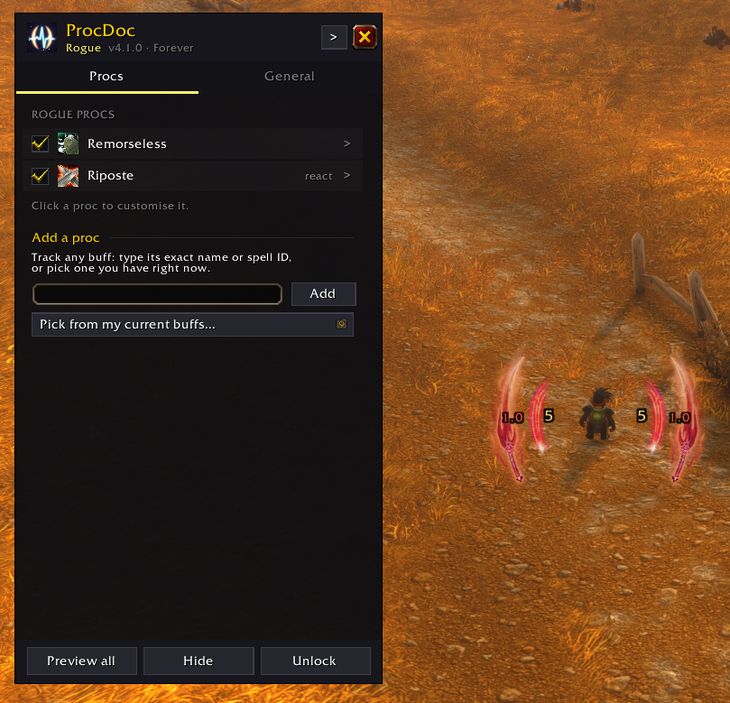
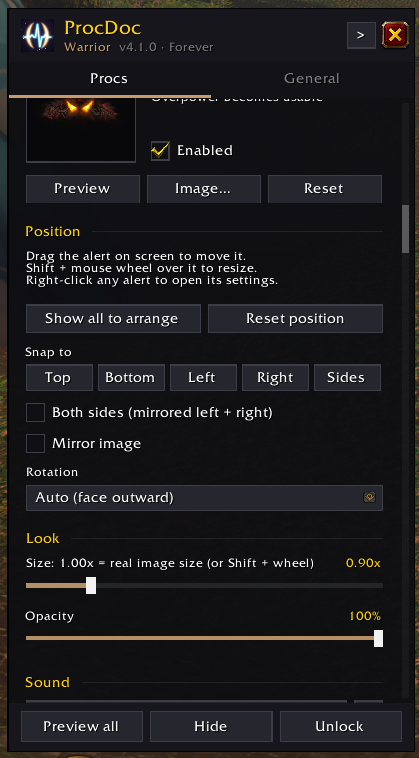

  

<h1 align="center">ProcDoc</h1>

<b>Never miss a proc again.</b> Big, pulsing proc alerts for World of Warcraft: Forever.

---

**ProcDoc** is a lightweight addon for **World of Warcraft: Forever**. It shows big pulsing visuals the moment you get a proc worth reacting to (Clearcasting, Shadow Trance, Overpower, Riposte and so on), so you never miss one.

It works out of the box: install it and procs light up. When you want to, every alert can be arranged and styled right on screen with the mouse.

## Screenshots

  

<i>Alerts in combat, each with its own countdown.</i>

  
  

<i>The options window sits beside your alerts. Every proc can be placed, sized and styled.</i>

---

## Key Features

1. **Visual alerts for procs**: pulsing images around your character whenever a proc is active, with a sound and a countdown. Each alert **pops in** with a bright flash the moment the proc happens, and quickly **shrinks away** when the proc is used or runs out.
2. **Drag-and-drop layout**: with the options open, drag any alert to where you want it. **Shift + mouse wheel** over an alert resizes it. Each alert can also be shown on **both sides** of the screen as a mirrored pair.
3. **Customisable countdowns**: drag the number to any spot on its alert, and Shift + wheel over it to resize it. Choose the font, outline, colors, when it turns "running out", and whether to show tenths.
4. **Your own procs**: track any buff by name or spell ID, or pick one you have right now (in combat, pick from the buffs you had earlier). You can also add an ability and have its alert show while it's **on cooldown**, counting down until it's back (like Kick or Sprint), or while it's **available** to use (great for practicing a rotation). Both work in and out of combat. Anything the game flags with its own proc glow is also picked up automatically.
5. **Buff reminders**: set any buff to alert when it's **missing** instead, like Slice and Dice, an armor or Intellect, so you know to put it back, in or out of combat.
6. **Reaction abilities without action bars**: Overpower, Revenge, Riposte, Counterattack and Mongoose Bite light up when they become usable.
7. **Clears when used**: alerts go away as soon as the proc is spent, even in combat, where Forever hides buff details from addons.
8. **Options that are easy to find your way around**: one list of every proc, with the ones you've ticked on top. Click a proc for its own page, with tabs for when it alerts, its look, where it shows, its timer and its stacks. General settings are split into Alerts, Timers, Sound and Setup.

---

## Installation

**CurseForge app (easiest):** search for **ProcDoc** and click Install. Updates arrive automatically.

**Manually:**
1. Download the latest release zip from CurseForge.
2. Unzip it so the addon sits at `World of Warcraft\_forever_\Interface\AddOns\ProcDoc\`.
3. Restart the game (or `/reload` if it's already running).
4. Make sure **ProcDoc** is enabled in the AddOns list at character select.

---

## How to Use

**The first time ProcDoc runs, a short setup wizard opens**, styled like one of the game's quest windows. In five steps it shows you your alerts, checks that Blizzard's Cooldown Manager is set up so your procs show in combat (with a **Reload now** button if a reload would finish it), lets you hide the Cooldown Manager's own icons, points you to your proc list and to arranging your alerts, and tells you what to do if a proc doesn't show. Run it again any time with `/procdoc setup`, or from `/procdoc` > Settings > Setup > **Run the setup wizard**.

1. **Log in** with any class.
2. **Get a proc.** The alert pulses on screen with a countdown and a sound.
3. **Customise (optional).** Click the **ProcDoc minimap button**, type **`/procdoc`** (or `/pd`), or open ProcDoc from the game's AddOns settings or the addon compartment menu.

### Minimap button

- **Left-click:** open or close the options.
- **Right-click:** show all alerts to arrange them, and right-click again when you're done.
- **Drag:** slide it around the minimap edge. It remembers where you put it.
- **Hide or show it:** use **Show minimap button** in Settings > Setup, or `/procdoc minimap`.

### Arranging alerts

- While the options window is open, alerts on screen can be moved directly:
  - **Drag** an alert to move it.
  - **Shift + mouse wheel** over an alert to resize it.
  - **Drag the countdown number** to move it around on its alert.
  - **Shift + mouse wheel** over the number to change its size.
  - **Right-click** an alert to open its settings.
- **Show all to arrange** (or the **Unlock** button, or `/procdoc unlock`) shows every enabled alert at once, with a faint centre guide, so you can lay them out together.
- Previews stay on screen until you click **Hide** or close the window, and they run a sample countdown so you can style the timer.

### The options window

A slim panel docked near the side of the screen, so your alerts stay visible while you edit. **Drag its title bar** to put it anywhere: it remembers where you leave it, even after a reload. The header's dock button snaps it back to an edge, and **Window scale** (Settings > Setup) shrinks it for small screens.

- **Procs tab**: every proc for your class in one list. Tick one to turn it on; click it (the arrow at the end of each card) to open its page. At the bottom, **Add a proc** tracks any buff by name, spell ID, or from your current buffs.
- **Each proc's page**: a header that stays put while you scroll, with **< All procs**, **<** / **>** to step through the list, the alert's image (click it to change it), what the alert does, **Enabled** and **Preview**. Under it, five tabs:
  - **Alert**: **Alert me when** the buff shows up, or it's missing (a reminder). For spells you cast (your own procs and the Cooldown Manager's), also while it's on cooldown (counting down until it's back) or while it's available, and **Show for** how long an available ability stays up (or until you use it). **Only in combat** keeps an alert for fights (a missing Battle Shout, say). Overpower also has **Also in other stances**. Then its **Sound** (or the default), **Reset to default**, and **Remove from list** for your own and auto-detected procs.
  - **Look**: **Change image...** (any of the 99 images in `img\`, the spell icon, Blizzard's art, or your own file; hover one to try it on the alert), size (1.00x = the image's real pixel size, whatever your resolution; alerts start at 0.85x), opacity, **Mirror image** and **Rotation**. *Auto* rotation turns the art to face outward (where the alert sits decides which way); you can also pick 0 / 90 / 180 / 270 degrees.
  - **Place**: **Snap to** Top, Bottom, Left, Right or Sides (a mirrored left + right pair), then drag to fine-tune. Also **Both sides**, Show all to arrange and Reset position.
  - **Timer**: show the countdown or not, text size, color, on one side only (for pairs), and Reset countdown.
  - **Stacks** (buffs only): a row of dots shows how many stacks you have (none for a buff that doesn't stack). Filled dots are stacks you have and dim ones are the rest; the newest dot pops when you gain a stack. Choose **Show the alert at** N stacks, the **Number of dots** (auto uses the most stacks seen), the dot color, and dots on one side only. Drag the dots on screen to move them, or Shift + wheel over them to resize. **Test stacks** plays a pretend stacking buff through the alert so you can check it all without a real one.
- **Settings tab**, in four pages picked from the tabs along its top:
  - **Alerts**: the scale of every alert, **Show all to arrange**, and the **Centre point** every alert is placed around (move it if your character isn't in the middle of the screen, like a game spread over several monitors); the pulse (opacity, size, speed); the pop-in (on/off and strength) and the shrink-away when a proc ends; a **Replay animation** button.
  - **Timers**: the countdown's font, outline, size, opacity, color, "running out" color and threshold, and tenths.
  - **Sound**: mute, the default sound and the sound channel.
  - **Setup**: auto-detect, hiding Blizzard's own proc overlay, Blizzard's Cooldown Manager (**Hide its icons**), the minimap button, the window scale, and **Reset all settings**.

### Slash commands

| Command | What it does |
| --- | --- |
| `/procdoc` | Open / close the options |
| `/procdoc setup` | Run the setup wizard again |
| `/procdoc unlock` / `lock` | Show all alerts to arrange / stop |
| `/procdoc test` / `hide` | Preview every enabled alert for 30s / hide previews |
| `/procdoc stacktest [name]` | Play a pretend stacking buff (1 to 5 stacks, down to 3) through a proc's alert to check its stack dots |
| `/procdoc minimap` | Show / hide the minimap button |
| `/procdoc buffs` | List your current buffs with spell IDs |
| `/procdoc cdm hide` / `show` | Hide Blizzard's Cooldown Manager (it keeps working out of sight, so procs still show mid-fight) / show it again |
| `/procdoc cdm` | What the Cooldown Manager is tracking and what ProcDoc reads from it |
| `/procdoc check` | Check everything ProcDoc relies on: every spell number it uses (for every class) is in the game, Blizzard's Cooldown Manager is on, its Tracked Buffs row can see your buffs (not set to Hidden in Edit Mode, not hidden by something else), and how each of your procs is seen in combat |
| `/procdoc trace` | Record what ProcDoc sees (to diagnose a missed proc); `/reload` saves the log. `/procdoc trace show` prints the latest lines |
| `/procdoc debug` | Print Blizzard proc-overlay events, and the last skipped error |

### New ProcDoc art

Original images made for ProcDoc in the same glowing style, ready in the image picker:

| Image | Shape | Good for |
| --- | --- | --- |
| Frost Shards | side | Mage (frost) |
| Arcane Runes | top | Mage (arcane) |
| Fel Flame | side | Warlock |
| Demon Fire Arc | top | Warlock (Soul Fire) |
| Shadow Wisps | side | Warlock, shadow Priest, Rogue |
| Crimson Claws | side | Hunter, feral Druid |
| Venom Drip | side | Rogue (poisons), Hunter |
| Storm Arc | top | Shaman |
| Storm Vortex Arc | top | Shaman |
| Starfall Crescent | side | Druid (Eclipse) |
| Divine Rays | top | Paladin, Priest (great for custom procs) |
| Holy Flame Arc | top | Priest (Holy Purpose) |
| Radiant Feathers | top | Paladin (Infusion of Light) |
| Arrow Volley Arc | top | Hunter (Rapid Killing) |
| Ember Crown | top | Warrior |

Also in the picker, in the style of the game's own proc art:

| Image | Shape | Used for / good for |
| --- | --- | --- |
| Arcane Seal Stage 1, 2, 3 | side | Mage (arcane): a violet arcane crescent with one to three rune seals |
| Elemental Arc | side | Clearcasting for Shamans (Elemental Focus): fire, earth, lightning and frost |
| Void Crescent | side | Warlock, shadow Priest |
| Demon Ember Band | top | Decimation |
| Blue Lightning Streak | side | Flurry for Shamans |
| Arrow Stage 1, 2, 3 | side | Quick Shots (stage 3); one to three golden arrows |
| Shadow Nova | top | shadow Priest, Warlock |
| Green Fel Band, Fel Crescent, Fel Flame Streaks, Fel Storm Arc | top, side, side, top | Warlock |
| Tidal Arc | top | Shaman (water) |
| Blazing Storm Arc | top | Warrior, Hunter, fire |
| Silver Wisp Arc, Golden Lightning Streak | side | Rogue, Warrior |
| Violet Swirls, Jade Mist, Jade Swirl Crescent, Golden Bubble Stream | side | your own procs |

### Using your own images

Drop a `.tga` (power-of-two size, e.g. 128x256 or 256x128) into `ProcDoc\img\`. Then open a proc's image picker and type the file name (e.g. `MyProc.tga`) in the custom box. Full texture paths and file IDs work too.

---

## Supported Procs

ProcDoc only alerts on **reaction** procs, meaning something just happened that you should act on. It doesn't alert on buffs you maintain or on abilities that are simply off cooldown (if you want a nudge when a maintained buff drops, add it yourself and set it to remind you when it's missing). These are the talent and ability procs built in for Forever:

| Class | Built-in procs |
| --- | --- |
| Warlock | Shadow Trance (Nightfall), Decimation (its 10 sec window; Soul Fire doesn't use it up) |
| Mage | Clearcasting, Missile Barrage (Arcane Missiles keeps your Clearcasting while it's up), Arcane Blast (a seal on each side for every stack, 1 to 3, then a rune arc on top at 4), Fingers of Frost (left side at 1 stack, both sides at 2), Heating Up (with stack dots; used by Pyroblast), Wake of Fire (lights up on your killing blow) |
| Druid | Clearcasting (Wrath doesn't use it up), Nature's Grace, Eclipse (charge dots: each Wrath gives 2, up to 4, and each Starfire uses one) |
| Shaman | Clearcasting (Elemental Focus), Flurry, Maelstrom Weapon (the lightning builds with your stacks: stage 1 to 4, then wings at 5; read in combat from Lightning Bolt's mana cost) |
| Hunter | Quick Shots (Deadly Aspects), Rapid Killing, Counterattack, Mongoose Bite (after you dodge, or from Expose Prey: a 10 sec window) |
| Warrior | Enrage, Overpower (in Battle Stance; tick **Also in other stances** for the others), Revenge |
| Rogue | Remorseless Attacks (spent by Mutilate too), Riposte |
| Priest | Holy Purpose (from Searing Light: a free Holy Nova) |
| Paladin | Infusion of Light (faster Holy Light) |

Anything Forever adds is caught by **auto-detect** if the game shows its own proc glow for it. Anything else can be added with **Add a proc**.

**About combat:** Forever hides your buffs from addons while you're in combat, so ProcDoc reads them another way. Every built-in buff proc except two is in Blizzard's Cooldown Manager, and ProcDoc follows its icons mid-fight (matched by spell number from Forever's own game data, so it works in any client language). **Maelstrom Weapon** isn't in the Cooldown Manager: each stack takes 20% off Lightning Bolt's mana cost, which the game does show in combat, so ProcDoc reads the stacks from there. **Wake of Fire** and **Remorseless Attacks** also light up on your killing blow (an enemy dying at the same moment the buff lands on you, so a party member's kill doesn't set it off). The reaction abilities light up when the game says they're usable. Countdowns use each buff's real length from the game data (or what ProcDoc last saw).

**For the most accurate alerts, ProcDoc uses Blizzard's Cooldown Manager.** It can see your buffs in combat, so ProcDoc follows it: any proc in its **Tracked Buffs** or **Tracked Bars** (Shadow Trance, Clearcasting, Remorseless, Fingers of Frost and more) lights up and clears mid-fight exactly. ProcDoc always sets it up for you: it switches it on whenever it's off, adds your ticked procs to Tracked Buffs if they're not there, and makes sure those rows aren't set to **Hidden** in Edit Mode (a hidden row stops watching your buffs). A row that was set to Hidden stays out of sight (ProcDoc keeps it invisible instead). ProcDoc only reads the Cooldown Manager's icons; it never hooks or changes them. Forever hides a buff's time and stack count from addons in combat, so the countdown starts from the buff's full length (from the game data, or as ProcDoc last saw it), charge dots follow your casts (down as you spend them, up when a cast of yours gives more, like Wrath for Eclipse), recasting a buff you track (Slice and Dice) starts its countdown over (Arcane Blast is the game's own exception: a stack with each cast, up to 4, all ending 18 sec after the first cast), and if a buff is refreshed some other way mid-fight and outlasts its countdown, it stays up without a number. The tracking is set up at every logout or `/reload` (the game only allows it then), so on a new character, procs light up mid-fight from your first `/reload` on. ProcDoc leaves the Cooldown Manager on screen. **If you'd rather not see it, type `/procdoc cdm hide`** (`/procdoc cdm show` brings it back), or tick **Hide its icons** in `/procdoc` > Settings > Setup: it keeps working out of sight. Don't switch it off or set it to Hidden in Edit Mode to get it off the screen, because that's what stops procs showing mid-fight (ProcDoc switches it back on at your next login and tells you). Leave it visible if you use the Cooldown Manager yourself or an addon that restyles it. `/procdoc check` shows how each of your procs is seen in combat, and `/procdoc cdm` shows what it's tracking, and which of your procs the Cooldown Manager doesn't offer at all (those ProcDoc can only see out of combat).

When the Cooldown Manager is watching a proc, that's all ProcDoc goes by in combat; its other tricks (like spotting Remorseless from your killing blow) are only a backup for procs it can't see. Reaction abilities like Overpower and Riposte use the game's own "usable" state, the same thing that lights up their Cooldown Manager icon.

**Every Cooldown Manager spell is in your list.** The Procs tab lists your built-in procs and every other spell from your class's Cooldown Manager together, in one list (the Cooldown Manager ones start switched off). Tick any of them to get an alert: it slides up to join the ticked procs at the top, in the order you ticked them, and glows for a moment so you can see where it went. Unticking one leaves it in place until you tick something else, so the list doesn't jump while you work. Buffs on you (Slice and Dice) light up while you have them. Abilities with a cooldown (Kick, Gouge) show while they're on cooldown, counting down until they're back. Abilities without one (Rupture, Garrote) show while they're available to use (a moment short of energy still counts, so it doesn't flash every time you spend some). It all works in and out of combat: in combat, when the game hides cooldowns, ProcDoc counts from your cast (and reads the Cooldown Manager's icon when it can't). A cooldown that's reset early is caught from that icon too: tick **Stormstrike** and set it to "available", and it lights up the moment Improved Stormstrike resets it on a dodge or parry, not only when its normal cooldown is over. Change it on the spell's page under **Alert me when**, just like your own procs: a buff can be a reminder when it's missing, and an ability can switch between "on cooldown" and "available". No need to add them by hand (a ticked buff is added to Tracked Buffs at your next `/reload` too).

---

## License

Feel free to use, modify, or share **ProcDoc**. A mention or credit is welcome but not required. Enjoy your new proccing visuals!
